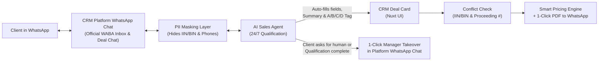

# Custom AI-Native CRM Platform (amoCRM Alternative) — Stakeholder Roadmap & Technical Plan

## 1. Goal & Strategic Business Case for Stakeholders

Originally, [ТЗ CRM продаж и ведения дел по взысканию.pdf](file:///Users/myrzanizimbetov/desktop/devhouse-projects/crm-frontend/%D0%A2%D0%97%20CRM%20%D0%BF%D1%80%D0%BE%D0%B4%D0%B0%D0%B6%20%D0%B8%20%D0%B2%D0%B5%D0%B4%D0%B5%D0%BD%D0%B8%D1%8F%20%D0%B4%D0%B5%D0%BB%20%D0%BF%D0%BE%20%D0%B2%D0%B7%D1%8B%D1%81%D0%BA%D0%B0%D0%BD%D0%B8%D1%8E.pdf) envisioned integrating an AI WhatsApp Sales Agent and custom legal/debt-collection automation into **amoCRM**. We are pivoting our strategy to build **our own self-hosted / cloud CRM platform** using **Nuxt, Nuxt UI, Tailwind CSS, Vue 3, and TypeScript**.

### Why Building Our Own CRM Beats amoCRM (`amocrm.ru/buy/?currency=tng`)

> [!IMPORTANT]
> **Critical Finding for Stakeholders:** Many requirements in [ТЗ CRM продаж и ведения дел по взысканию.pdf](file:///Users/myrzanizimbetov/desktop/devhouse-projects/crm-frontend/%D0%A2%D0%97%20CRM%20%D0%BF%D1%80%D0%BE%D0%B4%D0%B0%D0%B6%20%D0%B8%20%D0%B2%D0%B5%D0%B4%D0%B5%D0%BD%D0%B8%D1%8F%20%D0%B4%D0%B5%D0%BB%20%D0%BF%D0%BE%20%D0%B2%D0%B7%D1%8B%D1%81%D0%BA%D0%B0%D0%BD%D0%B8%D1%8E.pdf)—such as **mandatory fields on stage transitions**, **automated pipeline handoffs**, **Digital Pipeline triggers**, and **granular role permissions**—are **NOT available on amoCRM's Basic plan (5,199 ₸/user/mo)** and force customers onto **Extended (9,899 ₸/user/mo)** or **Professional (15,099 ₸/user/mo)** with a mandatory 6-month minimum commitment.

| Dimension | amoCRM Basic (`5,199 ₸/user/mo`) | amoCRM Extended / Pro (`9,899–15,099 ₸/user/mo`) | **Our Custom AI-CRM Platform** |
| :--- | :--- | :--- | :--- |
| **User Licensing Cost** | Paid per seat (min. 6 mos) | Paid per seat (min. 6 mos) | **Unlimited Users ($0 / 0 ₸ per additional user)** |
| **Open Deals & Contacts Limit** | 500 open deals / 5,000 contacts per user | 1,000–3,000 open deals per user | **Unlimited deals & contacts** |
| **File Storage (PDFs, Photos)** | Only **100 MB / user** (quickly exhausted by WhatsApp legal docs) | 200–400 MB / user | **Unlimited (S3 / MinIO in KZ data center)** |
| **Audit & History Retention** | Only **1 month** | 6 months (Extended) / Unlimited (Pro) | **Unlimited full audit log** |
| **AI Tokens (amoAI)** | 5,000 tokens/mo limit | 10,000–15,000 tokens/mo limit | **Native AI Sales Agent without artificial seat limits** |
| **WhatsApp Integration** | Requires paid 3rd-party widget (Wazzup/Radist) per channel | Requires paid 3rd-party widget | **✔️ Native Built-in WhatsApp Chat Workspace (WABA)** |
| **Mandatory Fields per Stage** *(Required by ТЗ §3)* | ❌ Locked | ✔️ Available | **✔️ Built-in natively in MVP** |
| **Digital Pipeline & Auto-Triggers** *(Required by ТЗ §3, §5, §8)* | ❌ Locked / severely limited | ✔️ Available | **✔️ Built-in natively in MVP** |
| **Granular Role Permissions** (`Руководитель`, `Юрист`, `Менеджер`) | ❌ Basic Admin/User only | ✔️ Available | **✔️ Built-in RBAC tailored to legal & sales roles** |
| **KZ Data Residency & PII Masking** *(Required by ТЗ §Безопасность)* | ❌ External cloud (RU) | ❌ External cloud (RU) | **✔️ Hosted in Kazakhstan + Built-in PII Masking (`ИИН/БИН`)** |

---

## 2. Complete Feature Scope: Basic Plan Parity + ТЗ Modules + Native WhatsApp & AI

### A. Core CRM Features & Native Platform WhatsApp Chat (Unlimited Users)
1. **Native Two-Way WhatsApp Chat Workspace (ТЗ §1 — Built Directly into Our Platform)**:
   - **Full Messaging from Our Platform**: Managers and lawyers read and reply to clients' WhatsApp messages directly inside our CRM (connected via official WhatsApp Business API)—never switching to a phone or external app.
   - **Dual Access Views**:
     - **Embedded Deal Chat (Split-Pane)**: Right half of every Deal Card shows the complete live WhatsApp thread alongside deal events and tasks.
     - **Dedicated Multi-Chat Inbox (`/inbox`)**: Full-screen WhatsApp operator workspace listing all active client conversations, unread counters, filter by `🤖 На опросе у ИИ` / `⚠️ Ждет менеджера` / `👤 Мои диалоги`, and instant Deal Card preview.
   - **Auto-Lead Creation**: Incoming WhatsApp message from a new phone number automatically creates a `Контакт` and a `Сделка` in stage `Новая заявка` → `Опрос AI`.
   - **Bidirectional Media & Document Vault**: Client photos and PDFs sent via WhatsApp render inline in the chat and automatically save to the Deal's `Документы` folder. Conversely, managers can send generated PDF Commercial Proposals and legal documents back into WhatsApp in 1 click.
   - **Quick Message Templates (WABA HSM & Quick Replies)**: 1-click insertion and sending of `Приветствие`, `Запрос документов`, `Напоминание`, and `Коммерческое предложение` with auto-filled client/deal variables.
2. **Multi-Pipeline Kanban & List Views (ТЗ §3, §8)**:
   - Drag-and-drop Kanban board with real-time totals (deal count, total debt amount, total service fee value per stage).
   - Multi-pipeline support out of the box: **Pipeline 1: «Продажи» (Sales)** and **Pipeline 2: «Ведение дел» (Case Management)**.
   - **Mandatory Stage Validation Rules** *(amoCRM Extended feature)*: Block moving a deal to `Квалифицирована` without `Сумма долга`, or to `Предложение отправлено` without `Решение по конфликту`, or to `Закрыто и не реализовано` without a mandatory rejection reason (including `Дорого относительно долга`).
3. **Unified Deal, Contact & Company Cards**:
   - Split-pane view: Left side for structured fields (Debt Info, Bailiff Info, Pricing, Documents) and Right side for the **Unified Timeline & Platform WhatsApp Chat**.
   - Custom field groups tailored for debt collection: `Сумма долга`, `Взыскано`, `Ситуация` (5 scenarios), `Стадия`, `Номер исполнительного производства`, `Судебный исполнитель`, `ИИН/БИН`.
4. **Role-Based Access Control (RBAC) — Unlimited Free Seats**:
   - **Руководитель (Executive / Head)**: Full access, pricing bracket matrix configuration, SLA working-day deadline rules, analytics/reports, Conflict of Interest resolution queue, overdue task escalations.
   - **Юрист (Lawyer)**: Assigned deals & active cases (`Ведение дел`), commercial proposals, document generation, SLA deadlines, WhatsApp communication with assigned clients.
   - **Менеджер (Sales Manager)**: Platform WhatsApp inbox, lead qualification, client follow-ups, commercial proposals.
5. **Tasks, Calendar & KZ Working-Day SLA Engine (ТЗ §9)**:
   - Task management (`Связаться`, `Заседание/Суд`, `Контроль ЧСИ`, `Проверка конфликта`) with calendar & list views.
   - **Kazakhstan Working-Day Calculator**: When a lawyer marks a procedural event (`Отправлено заявление`, `Получено постановление`), the system calculates the exact deadline in **KZ working days** (automatically skipping weekends and official Republic of Kazakhstan public holidays) and notifies the `Руководитель` on overdue tasks.

---

### B. Domain-Specific Modules from [ТЗ CRM продаж и ведения дел по взысканию.pdf](file:///Users/myrzanizimbetov/desktop/devhouse-projects/crm-frontend/%D0%A2%D0%97%20CRM%20%D0%BF%D1%80%D0%BE%D0%B4%D0%B0%D0%B6%20%D0%B8%20%D0%B2%D0%B5%D0%B4%D0%B5%D0%BD%D0%B8%D1%8F%20%D0%B4%D0%B5%D0%BB%20%D0%BF%D0%BE%20%D0%B2%D0%B7%D1%8B%D1%81%D0%BA%D0%B0%D0%BD%D0%B8%D1%8E.pdf)

1. **Dynamic Debt-to-Service Pricing Engine (ТЗ §4)**:
   - Auto-selects the recommended legal service package and price based on `Сумма долга` using brackets configured by the `Руководитель`.
   - Displays **Service Cost % of Total Debt** badge directly on the deal card.
   - **Smart Fee Alert**: If the fixed service fee exceeds a configurable threshold % of the debt, displays a warning and automatically suggests a lower-upfront / **Success-Fee (оплата частично по результату)** tariff.
2. **Automatic Lead Readiness Triage — Tags `A / B / C / D` (ТЗ §5)**:
   - **`A — Срочно`** (Red): Appeal deadline expiring soon; auto-creates a high-priority task for today for the assigned lawyer.
   - **`B — Готов`** (Green): Documents uploaded, debt amount fits criteria; ready to send Commercial Proposal.
   - **`C — Не готов`** (Yellow): Missing documents or unknown debt sum.
   - **`D — Не наш клиент`** (Gray): Debt sum too small or out-of-scope; triggers polite automated WhatsApp response with self-help instructions.
3. **Automated Conflict of Interest Gate (ТЗ §6)**:
   - Scans all existing Contacts, Companies, and Deals across both pipelines by `ИИН/БИН` and `Номер исполнительного производства`.
   - If a match is found (e.g., we already represent the opposing debtor/creditor), locks the deal from moving to `Предложение отправлено` and assigns an urgent **Conflict Resolution Task** to the `Руководитель` with a side-by-side comparison modal (`Разрешить` / `Отклонить из-за конфликта`).
4. **One-Click Document & Commercial Proposal Generator (ТЗ §4, §10)**:
   - 6 built-in templates (`Коммерческое предложение`, `Договор`, `Заявление об ознакомлении`, `Ходатайство`, `Повторное обращение`, `Жалоба`).
   - Auto-interpolates deal, client, bailiff, and pricing fields into Word (`.docx`) and `.pdf`, saves to the Deal card, and sends directly into the client's WhatsApp chat from our platform in one click.

---

### C. Value-Add AI Features in the CRM Interface (Beyond amoCRM & Base ТЗ)



1. **AI Sales Agent Live Control Bar & Handoff Console (Inside Platform WhatsApp Chat)**:
   - Visual status pill in every WhatsApp conversation: `🤖 AI-Агент ведет опрос` vs `👤 Менеджер в диалоге` vs `⚠️ Требуется человек`.
   - **Live Field Extraction Feed**: As the client answers in WhatsApp, managers see the AI highlight extracted values (`Ситуация: Судебный исполнитель бездействует`, `Сумма долга: 4 500 000 ₸`) and populate Deal fields with confidence badges.
   - **Structured AI Brief (Резюме ИИ)**: Pinned card at the top of the WhatsApp chat showing: *Суть ситуации*, *Текущая стадия*, *Чего не хватает из документов*, and *Рекомендуемый следующий шаг*.
   - **1-Click Takeover / Return to AI**: Managers can pause the AI agent mid-conversation with one click, type a WhatsApp message directly from the platform, or delegate document collection (`Дожать документы`) back to the AI agent.
2. **AI Co-Pilot "Smart Whisper" for Managers & Lawyers**:
   - Above the platform's WhatsApp message composer, an **"AI Подсказка" (Smart Reply)** bar suggests 2–3 context-aware replies based on the deal's current stage and missing fields.
   - **Objection Handler**: If the client writes *"Слишком дорого"*, AI Whisper immediately offers a 1-click reply explaining the partial success-fee option calculated from their debt bracket.
3. **AI Document Checklist & Pre-Screening Widget**:
   - Visual checklist inside the Deal card showing required documents for the selected scenario (e.g., `Решение суда`, `Исполнительный лист`, `Постановление ЧСИ`) and marking which files have been received via WhatsApp.
4. **PII Privacy Shield Indicator (ТЗ §Безопасность)**:
   - Visual badge in the WhatsApp chat & AI logs showing how `ИИН/БИН` and phone numbers were masked (`[ИИН_СКРЫТ]`, `[ТЕЛ_СКРЫТ]`) before being sent to the LLM.

---

## 3. Stages of Development (Stakeholder Roadmap)

| Stage | Milestone Name | Key Deliverables | Stakeholder Value |
| :--- | :--- | :--- | :--- |
| **Stage 1** | **Foundation, Unlimited RBAC & Core Pipelines** | • Auth & Unlimited User Management (`Руководитель`, `Юрист`, `Менеджер`)<br>• Sales Pipeline (`Воронка продаж`) & Case Pipeline (`Ведение дел`) Kanban + List views<br>• Deal Card with all Debt Collection custom fields & mandatory stage rules<br>• Contacts & Companies directory | Immediate replacement of amoCRM Basic/Extended UI with **$0 per-user licensing**. |
| **Stage 2** | **Platform WhatsApp Chat (`imBox`) & AI Sales Agent** | • Native two-way WhatsApp Business API chat inside Deal Card & dedicated `/inbox` page<br>• Media/PDF attachments synced between WhatsApp & Deal Documents<br>• AI Sales Agent status bar, live field extraction, AI Brief card (`Суть`, `Стадия`, `Чего не хватает`)<br>• Automatic A/B/C/D readiness tagging, PII Masking (`ИИН/БИН`), 1-click AI ⇄ Human takeover & WhatsApp templates | Full WhatsApp communication from our platform + 24/7 AI lead qualification. |
| **Stage 3** | **Pricing Engine, Conflict Check & 1-Click Proposals** | • Dynamic Debt-to-Price calculator + High fee % warning & alternative offer<br>• Automated Conflict of Interest scanner (`ИИН/БИН`, proceeding #) + Executive approval flow<br>• 1-click Commercial Proposal PDF generator & direct WhatsApp sender | Eliminates manual pricing errors and legal conflicts of interest; accelerates conversion. |
| **Stage 4** | **Case Management («Ведение дел»), KZ SLA & Legal Docs** | • Automatic deal transition from `Оплачена` to `Ведение дел` pipeline<br>• Kazakhstan Working-Day & Public Holiday deadline calculator + Overdue escalation<br>• 6 automated Word/PDF legal templates (`Договор`, `Ходатайство`, `Жалоба`, etc.) sent via WhatsApp | End-to-end post-sale legal execution without leaving the CRM. |
| **Stage 5** | **Executive Analytics & AI Smart Whisper** | • Conversion funnel by debt brackets & A/B/C/D tags<br>• Rejection reason analytics (`Дорого относительно долга`, etc.) + Excel export<br>• AI Co-Pilot Smart Reply suggestions in the WhatsApp composer | Full visibility for the `Руководитель` and higher manager productivity. |

---

## 4. Proposed Frontend Architecture (`crm-frontend`)

```text
crm-frontend/
├── plan.md                             # Saved stakeholder roadmap & implementation plan
├── nuxt.config.ts
├── package.json
├── app/
│   ├── app.vue
│   ├── layouts/
│   │   └── default.vue                 # Sidebar navigation, role switcher, unread WhatsApp badge, global search
│   ├── types/
│   │   ├── crm.ts                      # Deal, Contact, Pipeline, Stage, ReadinessTag (A/B/C/D), Role
│   │   ├── whatsapp.ts                 # WhatsAppMessage, WhatsAppAttachment, QuickTemplate, ThreadStatus
│   │   ├── ai-agent.ts                 # AIAgentState, AIBrief, PIIMaskingLog, SmartWhisper
│   │   └── legal.ts                    # PricingBracket, ConflictCheckResult, DocumentTemplate, KZDeadlineRule
│   ├── stores/
│   │   ├── useAuthStore.ts             # Current user role (Руководитель, Юрист, Менеджер) & unlimited team members
│   │   ├── usePipelineStore.ts         # Sales & Case Management pipelines, deals, mandatory stage validation
│   │   ├── useWhatsAppStore.ts         # Platform WhatsApp chats, sending messages/PDFs, templates, AI Agent handoff
│   │   └── useSettingsStore.ts         # Debt pricing brackets, KZ holiday calendar & SLA rules, doc templates
│   ├── components/
│   │   ├── pipeline/
│   │   │   ├── KanbanBoard.vue         # Drag-and-drop board with stage totals & A/B/C/D filters
│   │   │   ├── DealCardMini.vue        # Compact card showing debt sum, A/B/C/D badge, WhatsApp & AI status
│   │   │   └── StageValidationModal.vue# Mandatory field blocker (e.g. missing Debt Sum or Conflict Resolution)
│   │   ├── deal/
│   │   │   ├── DealSlideover.vue       # Full split Deal Workspace (Fields Left + Platform WhatsApp Chat Right)
│   │   │   ├── DebtPricingWidget.vue   # Auto price calculator, % of debt indicator, alternative tariff alert
│   │   │   ├── ConflictCheckBanner.vue # IIN/BIN & proceeding # match alert + Executive approval buttons
│   │   │   └── DocumentGenerator.vue   # 6 Word/PDF templates with 1-click generate & send to WhatsApp chat
│   │   ├── ai/
│   │   │   ├── AiAgentStatusBar.vue    # Live AI vs Human toggle inside WhatsApp chat, PII Masking shield
│   │   │   ├── AiBriefCard.vue         # Pinned AI summary (Суть, Стадия, Чего не хватает)
│   │   │   └── AiSmartWhisper.vue      # Contextual reply suggestions above WhatsApp input
│   │   └── chat/
│   │       └── WhatsAppThread.vue      # Native two-way WhatsApp chat, PDF/photo viewer, template picker, composer
│   └── pages/
│       ├── index.vue                   # Executive Dashboard & Stakeholder Overview
│       ├── sales/index.vue             # Часть 1: Воронка продаж (9 stages + AI qualification)
│       ├── cases/index.vue             # Часть 2: Воронка «Ведение дел» (8 stages + KZ working-day SLA)
│       ├── inbox/index.vue             # Full-screen Platform WhatsApp imBox (all client threads + AI live monitor)
│       ├── conflicts/index.vue         # Conflict of Interest resolution queue for Руководитель
│       ├── analytics/index.vue         # Reports: Funnel, Debt Brackets, A/B/C/D conversion, Rejection reasons + Excel export
│       ├── users/index.vue             # Unlimited Free Users & RBAC management
│       └── settings/index.vue          # Pricing matrix by debt sum, KZ SLA rules, Document templates
```

---

## 5. Verification & Delivery Plan

1. **Plan Persistence**: Saved to `plan.md` in root directory.
2. **Project Scaffolding**: Setup Nuxt 3/4 + `@nuxt/ui` + Tailwind CSS + TypeScript workspace.
3. **Data & Mock Service Layer**: Implement Pinia stores pre-populated with realistic Kazakhstan debt-collection deals, legal procedural stages, and WhatsApp conversations.
4. **Interactive Validation**:
   - Verify two-way WhatsApp chat inside `/inbox` and embedded within deal cards.
   - Verify stage validation guards preventing movement to `Квалифицирована` without debt sum.
   - Verify dynamic pricing calculation with high fee warnings.
   - Verify conflict-of-interest alerts for duplicate IIN/BIN entries.
5. **Build Checks**: Verify `npx nuxi typecheck` and `npm run build` execute cleanly with zero errors.
